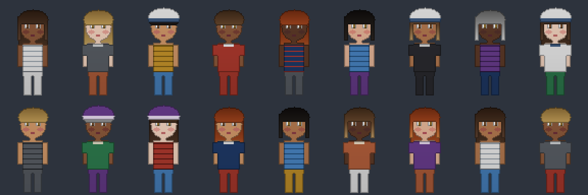

# Gerador de NPCs



Sorteia um `CharacterDescriptor` completo: uma peça por slot e cores tiradas de paletas curadas. O resultado é um descriptor comum, igual ao que o editor produz, e passa pelo mesmo `Resolver` e pelo mesmo bake.

```
NpcRules (npc_rules.json) + Contract + peças disponíveis + Random ─▶ NpcGenerator ─▶ CharacterDescriptor
```

C# puro, sem Godot. A mesma semente gera sempre o mesmo personagem, então um NPC pode ser guardado só como um número e recriado quando precisar.

```csharp
NpcRules rules = NpcRules.Load("res://data/npc_rules.json", contract);
CharacterDescriptor npc = NpcGenerator.Generate(rules, contract, catalog, new Random(seed));
```

No editor, o botão **NPC aleatório** faz isso com uma semente nova e mostra a semente na linha de status.

## `data/npc_rules.json`

```json
{
  "palettes": {
    "hair": [ { "base": "#6b4a2f", "r": "#3a2616", "g": "#8a6540", "b": "#c9a36b" }, ... ]
  },
  "slots": [
    { "slot": "body",      "chance": 1.0, "color_group": "skin" },
    { "slot": "hair_back", "chance": 0.4, "color_group": "hair" }
  ]
}
```

**Paletas.** Cada categoria tem uma lista de *conjuntos* de cores. Um conjunto traz uma cor para **todas** as regiões da categoria (a peça usa só as que declara). Como as cores de um conjunto foram escolhidas juntas (raiz mais escura que a base, rubor e lábios que combinam com o tom de pele), o sorteio não produz cabelo com raiz verde e pontas rosa. Combinações malucas continuam existindo, mas só pela roda de cor do editor ("for the lulz").

**Slots.** A lista é a ordem de sorteio.

- `chance`: `1` é sempre equipado; abaixo disso é a probabilidade de aparecer (chapéu 0,3, cabelo de trás 0,4).
- `color_group`: slots do mesmo grupo recebem o mesmo conjunto. É o que faz o cabelo da frente e o de trás combinarem. Os outros slots têm grupo próprio e sorteiam cores independentes (calça e camisa diferentes).
- `requires_tags`: a peça de um slot só é candidata se as tags que ela exige já foram fornecidas pelas peças sorteadas **antes** dela. Por isso `body` vem primeiro na lista. Um slot de `chance: 1` sem nenhuma peça compatível é erro; um slot opcional simplesmente fica vazio.

NPCs saem sem decalques.

## Validação

`NpcRules.Load` confere o arquivo contra o contrato e lança `InvalidDataException` com **todos** os problemas de uma vez:

- categoria de paleta que não existe no contrato, paleta vazia, conjunto cujas regiões não são exatamente as da categoria, cor que não é `#RRGGBB`;
- slot que não existe no contrato, repetido, com `chance` fora de (0, 1], sem paleta para a categoria dele, ou `color_group` que mistura categorias.

Como sempre no projeto: arquivo quebrado falha ao carregar, nunca no meio do jogo.

## Teste

O teste de fumaça confere:

- regras quebradas de várias formas geram a lista completa de erros;
- 200 sementes: cada uma gera o mesmo personagem duas vezes, resolve sem erro, tem todos os slots obrigatórios, e cabelo da frente e de trás têm a mesma cor base;
- variedade: mais de 150 descriptors distintos em 200, e as frequências de `hair_back` e `hat` batem com as chances;
- o botão **NPC aleatório** do editor troca o personagem sem erro;
- a montagem acima (sementes 0 a 17).

## Para o seu jogo

- **Paletas:** as cores atuais são um ponto de partida. Troque por conjuntos que combinem com a sua direção de arte (e com a pele e o cabelo dos seus povos, se o mundo tiver mais de um).
- **Mais peças:** peça nova entra no sorteio sozinha, porque o gerador lê o catálogo. Duas peças de camisa viram metade de cada slot, e assim por diante.
- **Pesos:** hoje toda peça e todo conjunto têm a mesma chance. Se quiser "cabelo grisalho raro", o passo seguinte é um peso opcional por conjunto.
